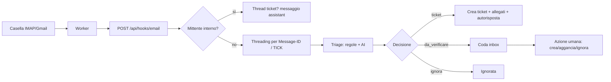

# Email a ticket

Percorso completo di un'email: dalla casella al ticket, passando per il triage.

## Diagramma

## Passi

1. **Lettura**: `lib/imap-worker.ts` o `lib/gmail-worker.ts` legge la casella e
   fa una POST al webhook. Gmail segna letto solo dopo il successo.
2. **Autenticazione webhook**: `x-webhook-secret` con confronto timing-safe;
   in produzione senza secret → `503`.
3. **Deduplica**: `email_inbox.message_id`; solo le righe in `errore` possono
   essere ritentate.
4. **Mittenti interni**: se interni e nel thread di un ticket, aggiungono un
   messaggio `assistant`; altrimenti ignorati e registrati.
5. **Threading** (`lib/threading.ts`): prima `Message-ID` in
   `email_log`/`email_inbox`, poi il token `[TICK-xxxx]` solo se il mittente
   coincide col ticket (o se interno).
6. **Triage** (`lib/email-classifier.ts`): regole sugli header
   (`Auto-Submitted`, `Precedence`, `List-Unsubscribe`, no-reply, oggetti
   automatici/promozionali), poi AI su OpenRouter con JSON validato e fallback.
7. **Decisione**:
   - `ticket`: crea il ticket `canale=email`;
   - `da_verificare`: coda umana con notifica;
   - `ignora`: scartata. Un cliente in anagrafica non viene mai scartato in
     silenzio: passa a `da_verificare`.
8. **Creazione ticket**: cliente risolto per email (fallback nome/mittente),
   modulo/priorità dal triage, primo messaggio = corpo email, allegati in
   `allegati_messaggi`, notifica, autorisposta con `In-Reply-To`.
9. **Riapertura**: se il thread punta a un ticket chiuso/risolto, il ticket
   torna `IN_CORSO` e l'operatore assegnato riceve una notifica.

## Azioni umane in inbox

| Azione | Cosa fa |
| --- | --- |
| `crea_ticket` | crea ticket canale email, priorità MEDIA, note con esito AI |
| `aggancia` | aggiunge il messaggio a un ticket (id o `TICK-…`) |
| `ignora` | stato `ignorata`, triage `ignora` |
| `recupera` | riporta a `da_verificare` |

## Dove guardare

- Pagina: `app/inbox/page.tsx`, `components/InboxDettaglio.tsx`
- Webhook: `app/api/hooks/email/route.ts`
- Classificatore: `lib/email-classifier.ts`
- Worker: [[Architettura/Runtime e processi|Runtime e processi]]
- Area: [[Aree/Email e Inbox|Email e Inbox]]

## Punti d'attenzione

> [!warning] Limiti
> - `triage_osservazione` è salvato ma non entra nella decisione.
> - Gli allegati email non hanno un endpoint di download.
> - Il triage può sbagliare: la coda "Da verificare" è la valvola di sicurezza,
>   non un dettaglio.
> - Un'email con `message_id` già visto non viene riprocessata.
