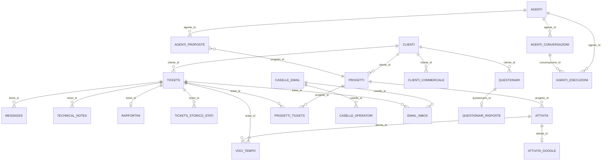

# Panoramica e ER

Il database è **Turso/libSQL**. Lo schema vive in `lib/db.ts`; l'elenco
completo e aggiornato delle colonne è in [[Modello dati/Tabelle|Tabelle]]
(generato automaticamente).

## Gruppi di tabelle

| Gruppo | Tabelle | Note |
| --- | --- | --- |
| Operatori e sessioni | `operatori`, `tentativi_login` | ruoli admin/operatore, revoca sessioni |
| Ticket | `tickets`, `messages`, `technical_notes`, `allegati`, `tickets_storico_stati` | canale, SLA, ore |
| Email | `email_inbox`, `email_log`, `allegati_messaggi` | inbox, invii, allegati ricevuti |
| Caselle | `caselle_email`, `caselle_operatori` | credenziali cifrate, accessi per operatore |
| Clienti | `clienti`, `clienti_commerciale` | anagrafica sincronizzata + dati locali |
| Questionari | `questionari`, `questionari_risposte` | token hashato, risposte JSON |
| Progetti | `progetti`, `attivita`, `progetti_tickets`, `attivita_google`, `etichette`, `attivita_etichette` | task, collegamenti, sync Google |
| Tempo | `voci_tempo` | cronometro; una voce aperta per operatore |
| AI | `agenti`, `agenti_esecuzioni`, `agenti_conversazioni`, `agenti_assegnazioni`, `agenti_proposte` | agenti, log, thread, proposte |
| Documenti | `knowledge_docs`, `knowledge_links` | testo PDF estratto, link |
| Rapportini | `rapportini` | snapshot cliente, ore, stato |
| Sicurezza/API | `chiavi_api`, `chiavi_idempotenza` | hash chiavi, risposte idempotenti |
| Sistema | `notifications`, `notifications_lette`, `impostazioni`, `registro_attivita` | notifiche, config, audit |

## Relazioni principali

> [!info] Nomi nel diagramma
> Le entità sono in maiuscolo e senza accenti; `caselle_email` appare come
> `CASELLE_EMAIL`. La fonte vera resta [[Modello dati/Tabelle|Tabelle]].

## Convenzioni trasversali

- **ID** `TEXT`: UUID per le entità create dall'app, id opachi per i clienti
  (possono arrivare da Arca).
- **Date**:
  - audit (`data_creazione`, `data_aggiornamento`, `chiuso_il`, ...) in ISO UTC;
  - calendario (`data_inizio`, `data_scadenza`) in `YYYY-MM-DDTHH:mm` **ora di
    parete**, mai UTC.
- **JSON**: `persone`, `strumenti`, `payload`, `links`, `voci`, `risposte`.
  Sempre decodificati nel data layer.
- **Nessuna FK applicata**: cancellazioni e pulizie sono esplicite.
- **Soft delete**: `tickets.eliminato_il` per conservare lo storico email.
- **Impostazioni**: `impostazioni.chiave/valore` per SLA, Google, contatori.

## Dove guardare

- Colonne complete: [[Modello dati/Tabelle|Tabelle]]
- Accesso e migrazioni: [[Architettura/Pattern dati e API|Pattern dati e API]]
- Tabelle per area: ogni nota di area ha la sua sezione "Tabelle"
